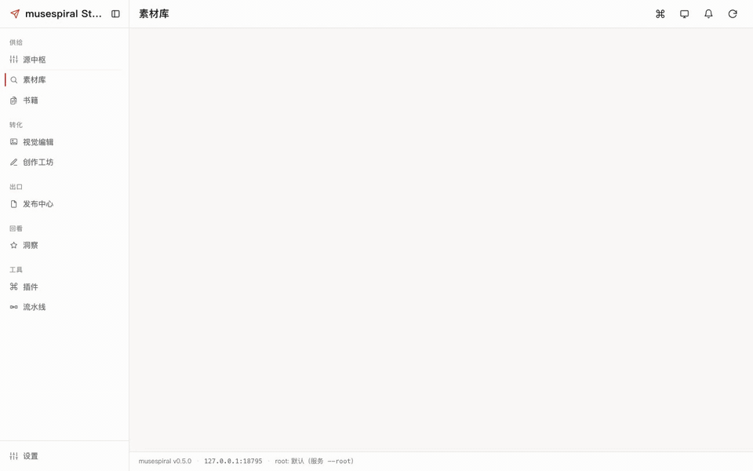
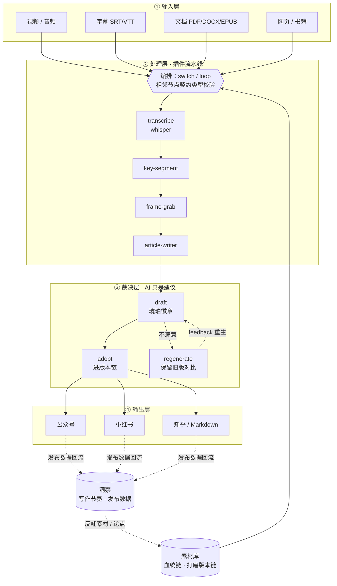

# musespiral

> **开源的内容流水线**：素材进来，成稿出去，每个 AI 判断你都能改。

[](LICENSE)
[](https://www.python.org/)
[](tests/)
[](https://github.com/psf/black)

**视频 / 音频 / 字幕 / 文档 / 网页 / 书籍 → 转写切片 → 结构化成稿 → 多平台发布 → 反哺回素材库**



> 25 秒看完：素材库 → 创作工坊的逐块裁决 → 文章里的时间戳锚 → 洞察里的写作节奏。

---

## 它解决什么问题

你有一个 8.5 小时的讲座视频，想把它变成一篇能发布的图文稿。

**传统做法**：看视频 → 手记 → 写稿 → 找图 → 排版 → 发布。耗时以天计。

**用 SaaS 工具**：上传 → AI 吐一篇稿 → 但你不能改它的判断（哪些是重点？怎么组织？），也不方便接回你的素材库。

**musespiral**：跑一条流水线，**每个 AI 判断都是建议，你决定采纳哪些**。

```bash
# 1. 找本地媒体
musespiral plugins list                          # 看 9 个内置插件
musespiral plrun run \
  --node "local-file:{path: /path/to/lecture.mp4}" \
  --node transcribe \
  --node key-segment \
  --node frame-grab \
  --node article-writer \
  --node material-sink

# 2. 产物：带时间戳锚的图文稿，每个 AI 判断都是 draft 态
#    - 切片：AI 建议 8 段 [全部采纳] [逐条审查]
#    - 成稿：AI 建议稿 [采纳] [重新生成] [对比两版]

# 3. 有字幕就跳过 ASR（快 100 倍，准确率 100%）
musespiral plrun run \
  --node "subtitle:{subtitle_path: lecture.srt, media_path: lecture.mp4}" \
  --node key-segment --node frame-grab --node article-writer --node material-sink
```

---

## 三个核心差异

### ① 时间戳锚：文章可回溯到视频原处

```markdown
## 多头注意力的并行扩展

[00:03:35](#t=215) 上一页我们学会了单个注意力怎么算，可只从一个角度看句子
难免片面，所以这一页把它升级成多头。


*图：00:03:35 处关键帧（来源片段 00:03:35–00:03:37）*
```

**这是「视频转文章」相对于「看视频」的唯一增量**——不是把视频变成字，是让文字可回溯。

现有竞品（markitdown / docling / gpt-researcher / storm）**都没有这个能力**。

### ② AI 产物默认是「建议」不是「结论」

```
AI 产出 → [draft 建议] → 人工裁决 → [adopted 正式]
              ↓                        ↓
         [discarded 弃用]         可用可发布
```

- 每条 AI 判断（切片 / 成稿 / 摘要）带 `draft` 状态 + 琥珀徽章
- 可**采纳** / **重新生成**（保留旧版供对比）/ **弃用**
- 一次提炼不满意？带 feedback 重生成 → 进版本链 → 两版 diff → 回退也进链

**默认保守，但允许切全自动**（`auto_adopt: true`）——信任 AI 的用户不被强制审查。

### ③ 飞轮闭环：发布出去的内容能回流

```
外部源 → 素材池 → 创作 → 发布
   ↑                       ↓
   └──── 反哺 ←────────────┘
```

- 已发布文章可反哺回素材库（全文归档 / 段落摘取 / AI 提炼论点）
- `⌘⇧I` 灵感速记：任意视图按一下，一句话进素材库
- 素材有血统链（`provenance.chain`）+ 打磨版本链（v1/v2/v3 + diff + 回退）

---

## 架构总览



四个层各自独立可替换：换转写器只动 `transcribe`，换平台只动输出适配器；**裁决层是唯一的人工闸门**，AI 永远只产出 `draft`。

---

## 快速开始

```bash
git clone <repo> && cd musespiral
python3 -m venv .venv && source .venv/bin/activate
pip install -e ".[test]"

# 可选：音视频转写（约 85MB + 首次下模型 1.6GB）
pip install faster-whisper

# 可选：文档提取（PDF/DOCX，约 7MB）
pip install pdfplumber python-docx

pytest -q   # 3212 passed, 1 skipped
```

启动本地工作台（11 个视图，Studio 只绑 127.0.0.1，数据不出本机）：

```bash
musespiral studio --root tests/fixtures/studio_demo
# → http://127.0.0.1:8766
```

视图：发布中心 / 素材库 / 书籍 / 视觉编辑 / 创作工坊 / 洞察 / 源中枢 / 设置 / 文章详情 / 插件清单 / 流水线运行

---

## 插件系统

**契约优先于实现**：插件之间只通过 10 种类型化契约通信，不共享内存、不互相 import。

```json
{
  "id": "transcribe",
  "kind": "process",
  "inputs":  { "media_path": {"type": "file/path", "required": true} },
  "outputs": { "transcript": {"type": "segments"} },
  "runtime": { "type": "python", "entry": "plugin.py:run" },
  "permissions": ["fs:read"]
}
```

**这一条纪律让三件事同时成立**：
- **可替换**——faster-whisper → FunASR 只换一个插件，下游零改动
- **可静态校验**——保存流水线时检查相邻节点类型接不接得上
- **可跨语言**——`exec` runtime 支持任意可执行程序

### 内置 9 个插件

| 插件 | 类型 | 职责 |
|---|---|---|
| `local-file` | source | 校验本地媒体（9 种音视频格式） |
| `local-scan` | source | 扫描目录找音视频（roots 白名单 + 隐私目录硬排除 + 限额防卡死） |
| **`transcribe`** | process | 音视频转写（每段带 `avg_logprob` / `no_speech_prob` 质量信号） |
| **`subtitle`** | process | 字幕直出 segments（跳过 ASR，快 100 倍、准确率 100%） |
| **`doc-extract`** | process | PDF/DOCX/EPUB/MD/TXT → 文本（**纯标准库解析 EPUB，零 AGPL 依赖**） |
| `key-segment` | process | 识别关键段落（AI + 规则降级双路径） |
| `frame-grab` | process | 抽关键帧 / 裁剪片段（避开转场，窗口感知锚） |
| `article-writer` | process | 组织成带时间戳锚的图文稿（AI + 模板双路径） |
| `material-sink` | sink | 落库为素材（preview 态 + 血统链） |

**写自己的插件**：放一个目录到 `~/.musespiral/plugins/<id>/`，含 `manifest.json` + `plugin.py`。`manifest 即 UI`——插件详情页自动从清单渲染，不用写一行 HTML。

---

## 代码分层

上面的架构总览讲的是**数据怎么流**，这一节讲的是**代码怎么分层**——两者是同一件事的两个视角。

```
表示层    commands/ (CLI)  ·  studio/ (本地 Web 工作台)
   ↓
服务层    services/ (编排：compose / refine / pipeline / materials …)
   ↓
领域层    core/ (纯逻辑：plugins / materials / composition / version / tts …)
   ↓
基础设施  infra/ (AI 网关 / fetcher / media_gen / booksource …)
```

- **零外部依赖前端**：`ui.html` + `assets/core.js` + `assets/views/*.js`，零 CDN、零构建链、零 npm。视图按需懒加载（首屏 143KB / 预算 240KB）
- **分层用测试强制**：`core` 不得 import `infra`/`services`；`services`/`studio` 零直接网络（必经 `infra/fetcher`）

---

## 与竞品的关系

| 你需要的 | 用谁 |
|---|---|
| 只要文档转文本 | [markitdown](https://github.com/microsoft/markitdown)（★197K，格式最全） |
| 只要深度研究报告 | [gpt-researcher](https://github.com/assafelovic/gpt-researcher) / [storm](https://github.com/stanford-oval/storm) |
| 只要笔记管理 | [siyuan](https://github.com/siyuan-note/siyuan) / [joplin](https://github.com/laurent22/joplin) |
| **把素材跑成可发布的多平台内容，且能控制每个 AI 判断** | **musespiral** |

musespiral 不与它们竞争单项能力，而是**把「素材 → 成稿 → 发布 → 反哺」串成一条你能中途介入的流水线**。

---

## 设计原则

1. **AI 产物默认是建议**——`draft` 态可用但明确标记，用户决定是否采纳
2. **契约优先于实现**——插件间只通信类型化契约，可替换可校验
3. **本地优先**——核心零网络，数据不出本机，Studio 只绑 127.0.0.1
4. **诚实报错**——扫描版 PDF 明确拒绝而非返回空；缺依赖给可读指引而非 ImportError
5. **机器门优先于人工审查**——许可证、体积、分层、契约锁全部有测试兜底

---

## 状态

**Alpha**（v0.5 开发中）。核心链路已跑通：

- **3212 个测试通过**（1 个 e2e 需真机凭证，默认跳过）
- 9 个插件、11 个前端视图
- 真实素材验证：513 秒中文讲座 → 221 段转写 → 8 关键帧 → 带时间戳锚的图文稿 → 素材库

**未完成**：真实发布链路（需公众号凭证）、扫描版 PDF 的 OCR、`exec` runtime（非 Python 插件）。

---

## 许可证

[MIT](LICENSE)。依赖全部宽松许可（MIT / Apache-2.0 / BSD / LGPL），**零 AGPL/GPL 污染**（有机器门守护：`tests/test_license_compliance.py`）。

---

## 贡献

见 [CONTRIBUTING.md](CONTRIBUTING.md)。两条硬规则：

1. **不要引入 AGPL/GPL 依赖**——机器门会拦住你
2. **加了 AI 能力就要加裁决**——AI 产物默认 `draft`，用户能采纳 / 重生成 / 弃用
